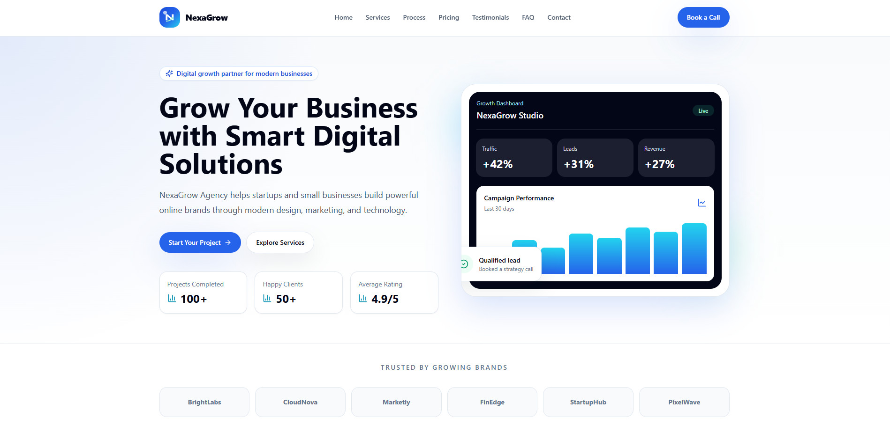
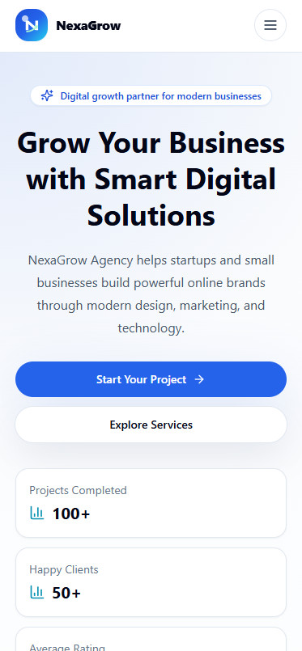

# Velocity Forge - Business & Digital Growth Landing Page

[](https://react.dev)
[](https://vitejs.dev)
[](https://tailwindcss.com)
[](https://lucide.dev)
[](LICENSE)
[]()

A high-performance, modern business and digital growth agency landing page built with **React**, **Vite**, and **Tailwind CSS**. Designed specifically for modern agencies, SaaS startups, digital consultancies, and technology-driven service providers looking for a client-ready, conversion-focused digital presence.

---

## 📑 Table of Contents

- [Overview](#-overview)
- [Primary & Alternative Contact Information](#-primary--alternative-contact-information)
- [Key Features](#-key-features)
- [Preview & Visual Assets](#-preview--visual-assets)
- [Tech Stack](#-tech-stack)
- [Landing Page Sections](#-landing-page-sections)
- [Project Structure](#-project-structure)
- [Getting Started](#-getting-started)
  - [Prerequisites](#prerequisites)
  - [Installation](#installation)
  - [Development Server](#development-server)
  - [Production Build](#production-build)
  - [Preview Production Build](#preview-production-build)
- [Deployment](#-deployment)
- [Form Validation & UX Flow](#-form-validation--ux-flow)
- [Contributing](#-contributing)
- [License](#-license)

---

## 🚀 Overview

**Velocity Forge** provides a blueprint for high-converting business landing pages. It combines an engaging aesthetic (rich gradients, subtle glow shadows, sleek dark accents, responsive layouts) with clear value propositions, transparent pricing, social proof, interactive FAQs, and a robust client inquiry system.

The code is architected with modular React components and a separated data layer in `src/data/`, making it effortless to customize branding, services, testimonials, pricing, and contact touchpoints for any client or enterprise.

---

## 📞 Primary & Alternative Contact Information

Velocity Forge provides multi-channel communication options to ensure immediate client onboarding, responsive technical support, and transparent SLA tracking.

| Communication Channel | Primary Contact | Alternative / Direct Channel | Operating SLA / Coverage |
| :--- | :--- | :--- | :--- |
| **📧 Electronic Mail** | [contact@velocityforge.com](mailto:contact@velocityforge.com) | [support@velocityforge.io](mailto:support@velocityforge.io) | Initial response within 24 business hours |
| **📞 Voice & Hotline** | [+1 (555) 749-3820](tel:+15557493820) | [+1 (555) 835-6248](tel:+15558356248) | Mon – Fri: 9:00 AM – 6:00 PM PST<br>*(Alternative line: 24/7 client hotline)* |
| **🏢 Headquarters** | **Primary Corporate Office:**<br>450 Mission St, Suite 1200<br>San Francisco, CA 94105, USA | **Alternative Innovation Hub:**<br>100 Montgomery St, 18th Floor<br>San Francisco, CA 94104, USA | In-person strategy sessions by prior appointment |
| **💬 Project Inquiries** | Interactive Web Form on [Homepage](#contact) | Direct Email: [contact@velocityforge.com](mailto:contact@velocityforge.com) | Dedicated strategist assigned per request |
| **⏰ Business Hours** | Mon – Fri: 9:00 AM – 6:00 PM PST | 24/7 Client Emergency Hotline | Guaranteed weekend support for active deployments |

---

## ✨ Key Features

- **Dynamic Brand Identity**: Custom vector SVG monogram (`VF` velocity forge mark) with matching browser favicon and logo assets.
- **Sticky Glassmorphism Header**: Clean desktop navbar with mobile hamburger toggle and smooth scroll navigation.
- **Conversion-Optimized Hero**: Impactful headline, dual CTA buttons, live metrics badge, and simulated interactive growth dashboard.
- **Social Proof & Client Badges**: Curated grid of trusted industry partners and enterprise client marks.
- **Modular Services Grid**: 6 core service capabilities with clean iconography, concise copy, and hover transitions.
- **Streamlined 3-Step Process**: "How It Works" workflow explaining discovery, implementation, and launch.
- **Tiered Transparent Pricing**: Multi-tier pricing packages (Starter, Growth, Scale) featuring a highlighted "Most Popular" card with full feature checklist.
- **Verified Testimonials**: Client endorsements with author initials, job titles, and star rating indicators.
- **Interactive FAQ Accordion**: Expandable and collapsible questions powered by native React state.
- **Controlled Contact Form**:
  - Live client-side input validation (name, email, project message).
  - Inline error feedback with accessible styling.
  - Success message banner upon valid submission.
  - Display of both primary and alternative contact channels with clickable links.
- **Complete Responsive Footer**: Brand overview, quick links, service catalog, primary & alternative contact details, and copyright notices.
- **Mobile First & Fully Responsive**: Tailored viewport adjustments for mobile, tablet, laptop, and ultrawide screens.

---

## 🖼 Preview & Visual Assets

### Desktop View


### Mobile View


---

## 🛠 Tech Stack

| Technology | Role | Version |
| :--- | :--- | :--- |
| **[React](https://react.dev)** | Component UI library & state management | `^19.0.0` |
| **[Vite](https://vitejs.dev)** | Lightning-fast development server & production bundler | `^7.0.0` |
| **[Tailwind CSS](https://tailwindcss.com)** | Utility-first responsive CSS styling | `^3.4.17` |
| **[Lucide React](https://lucide.dev)** | Modern, accessible SVG icon set | `^0.468.0` |
| **[PostCSS](https://postcss.org)** & **[Autoprefixer](https://github.com/postcss/autoprefixer)** | Automated vendor prefixing and CSS transformation | `^8.4.49` / `^10.4.20` |

---

## 🧩 Landing Page Sections

The application is structured into 10 cohesive sections:

1. **Navbar** (`src/components/Navbar.jsx`): Responsive header with brand logo, quick navigation links, and mobile toggle.
2. **Hero** (`src/components/Hero.jsx`): Hero banner with badge, key stats, CTAs, and live SaaS dashboard graphic.
3. **Trusted Brands** (`src/components/ClientLogos.jsx`): Partner and brand logo showcase.
4. **Services** (`src/components/Services.jsx`): 6-card service showcase detailing Web Design, Branding, Marketing, SEO, Automation, and Support.
5. **How It Works** (`src/components/HowItWorks.jsx`): 3-step project delivery methodology.
6. **Pricing** (`src/components/Pricing.jsx`): Starter, Growth, and Scale plans with detailed inclusions.
7. **Testimonials** (`src/components/Testimonials.jsx`): Real-world client reviews with 5-star ratings.
8. **FAQ** (`src/components/FAQ.jsx`): Interactive accordion answering common business and timeline questions.
9. **Contact & Alternative Channels** (`src/components/Contact.jsx`): Interactive inquiry form paired with primary & alternative contact details.
10. **Footer** (`src/components/Footer.jsx`): Multi-column footer with legal notice, sitemap links, and direct contact avenues.

---

## 📂 Project Structure

```text
Velocity-Forge/
├── .github/
│   └── workflows/
│       └── ci.yml             # GitHub Actions CI build check
├── docs/
│   └── screenshots/           # Desktop and mobile preview screenshots
│       ├── desktop-preview.jpg
│       └── mobile-preview.jpg
├── public/
│   ├── favicon.svg            # Custom Velocity Forge vector browser icon
│   ├── logo.svg               # Complete vector logo with wordmark
│   └── preview.svg            # Social share & OpenGraph graphic
├── src/
│   ├── components/            # Reusable UI elements and page sections
│   │   ├── BrandLogo.jsx      # Velocity Forge vector mark and logo text
│   │   ├── Button.jsx         # Primary, secondary, outline, and dark button variants
│   │   ├── ClientLogos.jsx    # Partner and client brand bar
│   │   ├── Contact.jsx        # Form with validation + Primary/Alternative contact cards
│   │   ├── FAQ.jsx            # Accordion state controller
│   │   ├── FAQItem.jsx        # Accordion item row with toggle animation
│   │   ├── Footer.jsx         # Comprehensive multi-column footer
│   │   ├── Hero.jsx           # Value prop hero with live metrics dashboard
│   │   ├── HowItWorks.jsx     # 3-step workflow roadmap
│   │   ├── Navbar.jsx         # Sticky navigation and mobile drawer
│   │   ├── Pricing.jsx        # Pricing section container
│   │   ├── PricingCard.jsx    # Card with plan features and CTA
│   │   ├── SectionHeader.jsx  # Consistent section eyebrow, title, and description
│   │   ├── ServiceCard.jsx    # Individual service card with icon
│   │   ├── Services.jsx       # Services grid container
│   │   ├── TestimonialCard.jsx# Testimonial card with rating stars and author badge
│   │   └── Testimonials.jsx   # Testimonials grid container
│   ├── data/                  # Decoupled content data files
│   │   ├── clients.js         # Partner names
│   │   ├── faqs.js            # Frequently asked questions and answers
│   │   ├── navigation.js      # Navigation and footer menu links
│   │   ├── pricingPlans.js    # Pricing packages, features, and tiers
│   │   ├── processSteps.js    # 3-step delivery milestones
│   │   ├── services.js        # Service titles, descriptions, and icon mappings
│   │   └── testimonials.js    # Client reviews and satisfaction ratings
│   ├── App.jsx                # Main page assembly
│   ├── index.css              # Tailwind base, utilities, and custom shadows
│   └── main.jsx               # Application entry point
├── index.html                 # HTML entry with SEO meta tags, title & favicon
├── package.json               # Dependencies and build scripts
├── package-lock.json          # Dependency lockfile
├── postcss.config.js          # PostCSS configuration
├── tailwind.config.js         # Tailwind theme customizations and color palette
├── vite.config.js             # Vite bundler configuration
└── README.md                  # Comprehensive project documentation
```

---

## ⚙ Getting Started

### Prerequisites

- **Node.js**: Version `18.0.0` or higher
- **npm**: Version `9.0.0` or higher (or `pnpm` / `yarn`)

### Installation

Clone the repository and install all project dependencies:

```bash
# Clone the repository
git clone https://github.com/shantopaul/Business-Landing-Page.git Velocity-Forge

# Navigate into the project directory
cd Velocity-Forge

# Install dependencies
npm install
```

### Development Server

Start the local development server with hot module replacement (HMR):

```bash
npm run dev
```

The application will be accessible at `http://localhost:5173`.

### Production Build

Compile and bundle the application into the optimized `dist/` folder:

```bash
npm run build
```

### Preview Production Build

Serve the compiled production bundle locally to inspect final asset performance:

```bash
npm run preview
```

---

## 🌐 Deployment

The application is fully static and can be deployed instantly to any modern hosting platform:

### Deploying to Vercel

1. Push your repository to GitHub.
2. Log into **Vercel** and select **Add New Project**.
3. Import the repository.
4. Framework preset will automatically detect **Vite**.
5. Click **Deploy**.

### Deploying to Netlify

1. Connect your repository in **Netlify**.
2. Set the build command to `npm run build`.
3. Set the publish directory to `dist`.
4. Deploy the site.

---

## 🛡 Form Validation & UX Flow

The contact form in `src/components/Contact.jsx` provides immediate user feedback:

1. **Full Name**: Verified to ensure non-empty submission.
2. **Email Address**: Checked for required presence and valid email format (`@` check).
3. **Project Details**: Ensures the message field contains actionable project scope.
4. **Instant Feedback**: Errors are displayed directly below each input field with red focus highlights.
5. **Success State**: Submitting valid information resets input values and displays an immediate confirmation banner: *"Thank you! We received your message and will reach out shortly."*

---

## 🤝 Contributing

Contributions, feedback, and feature suggestions are welcome!

1. Fork the Project.
2. Create your Feature Branch (`git checkout -b feature/NewSection`).
3. Commit your Changes (`git commit -m 'feat: Add new case study section'`).
4. Push to the Branch (`git push origin feature/NewSection`).
5. Open a Pull Request.

---

## 📄 License

Distributed under the **MIT License**. See `LICENSE` for details.

---

<p align="center">
  <b>Velocity Forge</b> &bull; High-Performance Digital Solutions &bull; &copy; 2026 All Rights Reserved.
</p>
